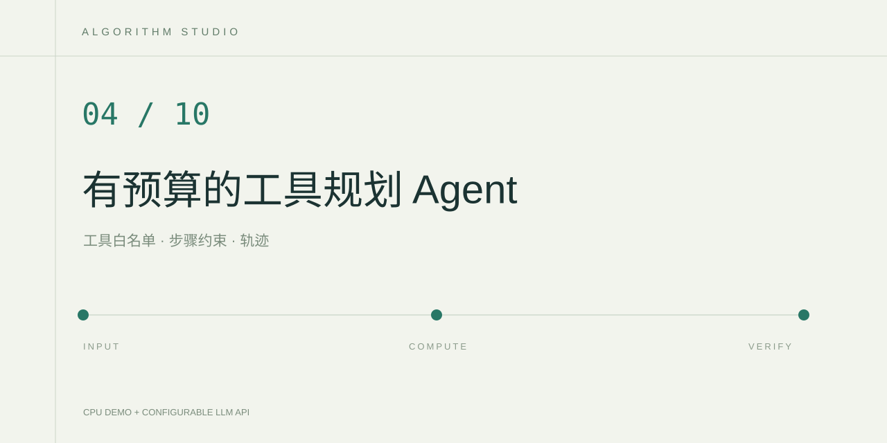

# 有界工具规划 Agent

一个可以观察每次函数调用的工业数据分析实验。输入设备问题，程序依次执行传感器统计和算术计算，展示工具名、参数、实际结果和停止原因。

数据来自项目自编的 `data/synthetic_sensors.json`。其中只有 P-101、P-102 两台合成设备，不对应任何企业生产记录。

## 运行

在 PyCharm 中直接打开本文件所在的项目文件夹，选择 Python 3.12 解释器，在该环境中安装 `requirements.txt` 的依赖。右键运行 `app.py`，打开运行窗口显示的本地网址。页面默认使用本地演示，不需要显卡或 API 密钥。

可以输入“分析设备 P-101 最近 5 次温度，计算平均值超过阈值 70 的差值”。本地模式能识别设备编号、温度或压力或振动、窗口数量和数值阈值。窗口在 1～100 条之间，实际样本少于窗口时会报告实际条数。

API 模式需要将 `.env.example` 复制为 `.env` 并填写 `LLM_API_KEY`、`LLM_BASE_URL`、`LLM_MODEL`，然后在页面切换到 API 模式。模型使用结构化 JSON 规划协议选择工具。后端执行通过校验的函数，再把真实结果发回模型，最多规划 5 步。云端 API 会产生对应平台的调用费用。

## 核心实现

- `sensor_summary` 从合成记录计算最近若干条样本的均值、最小值和最大值。
- `calculate` 使用 Python AST 解释加减乘除，不使用 `eval`，拒绝函数调用、属性访问和幂运算。
- 调度器校验工具白名单与参数字段，限制数值范围、表达式长度和步骤数量。
- 同一工具与参数出现第二次时停止，避免无效循环。未知设备和错误参数进入执行轨迹。

本地演示会真实调用两个工具。API 模式中的最终解释由模型生成，页面同时展示计算依据。程序只校验调用协议和执行边界，模型解释是否准确仍需要人工核对。

## 验证

在项目终端运行 `python -m unittest discover -s tests -v`。测试覆盖运算优先级、非法代码、参数校验、真实数据均值、两个工具组合、重复调用停止、未知设备、空输入和不相关任务。

进一步评估可以准备设备、窗口和指标不同的固定问题集，检查工具选择是否正确、参数是否有效、计算是否与手工结果一致，同时记录工具调用次数、停止状态和 API 延迟。测试前固定问题集，避免只报告示例问题。

## 参考

- Python AST 官方文档。https://docs.python.org/3/library/ast.html
- DeepSeek 工具调用文档。https://api-docs.deepseek.com/zh-cn/guides/tool_calls/

这是应用级规划与工具执行实验。合成记录上的计算结果只用于检验流程，不能用于真实设备的故障诊断。
